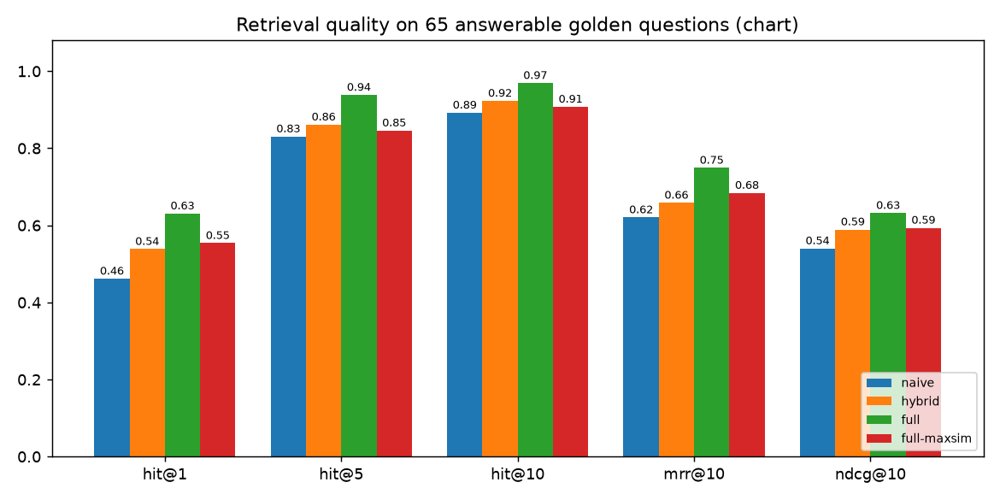
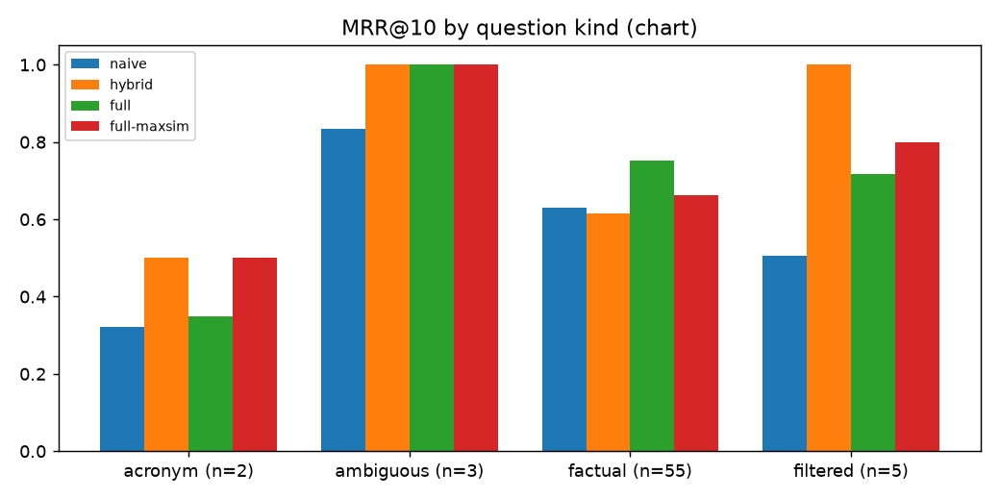
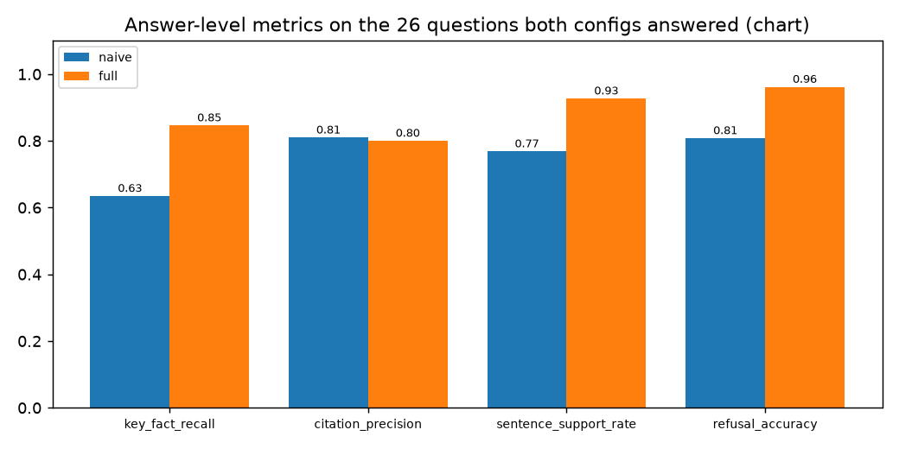

# cited-rag

Question answering over five NIST PDFs (AI RMF, Generative AI Profile, CSF 2.0, SSDF,
Privacy Framework). Every answer sentence cites a source with its PDF page number, each
sentence is checked against the source it cites, and out-of-scope questions get "no
answer" instead of a guess. There's an eval harness with 77 golden questions and a
benchmark of a naive baseline against the full pipeline.

Everything except answer generation runs locally on CPU. Answers come from Groq.

## Why

Plain top-k dense retrieval is fine for a demo and weak for real use: identifiers like
`PW.1.1` or `GV.SC` get lost in embeddings, there's no way to tell how confident a
retrieval is, and the model's citations aren't checked. This repo builds each fix, then
measures what it actually buys on a golden set written by reading the documents.

## What's in it

| feature | where |
|---|---|
| Page-cited answers (`[1]` -> `nist-csf-2.0, p. 12`) | `answer.py`, `types.py` |
| Hybrid search: bge-small dense + BM25, fused with RRF (k=60) | `retriever.py`, `sparse.py`, `fusion.py` |
| Cross-encoder rerank (ms-marco-MiniLM-L-6-v2) of the top 30, keep 10 | `rerank.py` |
| Configurable chunking, default 500 tokens / 50 overlap, inside section bounds | `chunking.py`, [DESIGN.md](DESIGN.md) |
| Query expansion (acronym glossary mined from the corpus, optional LLM paraphrases) | `query.py` |
| Query rewriting for ambiguous questions (LLM, only when flagged ambiguous) | `query.py` |
| Metadata filters: doc, topic, section, year, page range | `filters.py` |
| Sentence-level citation grounding, flag or drop unsupported sentences | `grounding.py` |
| Refusal on low retrieval confidence, threshold calibrated on half the golden set | `eval/calibrate.py`, `config.py` |
| Web search fallback behind a flag, pluggable provider, off by default | `websearch.py` |
| Parent document retrieval (search children, read parent windows) | `chunking.py`, `answer.py` |
| On-disk embedding cache keyed by content hash (SQLite) | `cache.py`, `embed.py` |
| Late interaction (MaxSim over token embeddings) as an optional reranker | `rerank.py` |
| Eval harness: hit@k, MRR, NDCG@k, refusal accuracy, citation precision, grounding | `eval/` |
| Golden set: 77 cases, key facts checked against the PDF pages in tests | `eval/golden.jsonl`, `tests/test_golden.py` |
| Streamlit dashboard | `dashboard/app.py` |
| CLI: `ingest`, `query`, `eval`, `bench`, `cache-bench` | `cli.py` |

## Run it

```bash
python -m venv .venv && . .venv/bin/activate
pip install torch --index-url https://download.pytorch.org/whl/cpu
pip install -e ".[dev,dashboard,charts]"
python scripts/fetch_data.py                     # downloads the PDFs, checks sha256

cited-rag ingest --config full                   # parse, chunk, embed (~14 s on CPU)
cited-rag query "What are the four CSF Tiers?" --retrieve-only
cited-rag query "What does PW.1.1 suggest?" --filter doc=nist-sp-800-218-ssdf

export GROQ_API_KEY=...                          # only needed for answers
cited-rag query "How does NIST define confabulation?"

cited-rag bench --configs naive,hybrid,full,full-maxsim     # retrieval only, no LLM
cited-rag bench --answers full,naive                        # answer eval, rate limited
cited-rag cache-bench
python scripts/answer_subset.py naive full && python scripts/make_charts.py
streamlit run dashboard/app.py
```

The model defaults to `openai/gpt-oss-120b`; set `CITED_RAG_MODEL` to change it and
`CITED_RAG_TPM` to change the tokens-per-minute pacing (default 7000).

## Results

All numbers below come from the files in `results/`. Retrieval runs never call an LLM.

Configs:

* **naive**: dense only, 500-token chunks with no overlap, no BM25, no rerank, no
  expansion, chunk text as context.
* **hybrid**: dense + BM25 with RRF, 500/50 chunks, acronym expansion, no rerank.
* **full**: hybrid + cross-encoder rerank + parent context.
* **full-maxsim**: hybrid + MaxSim rerank instead of the cross-encoder.

### Retrieval (77 golden cases: 65 answerable, 12 out of scope)

| config | hit@1 | hit@3 | hit@5 | hit@10 | MRR@10 | NDCG@10 | refusal acc (all) | refusal acc (held-out half) | out-of-scope refused | answerable refused | p50 latency |
|---|---|---|---|---|---|---|---|---|---|---|---|
| naive | 0.462 | 0.723 | 0.831 | 0.892 | 0.621 | 0.540 | 0.922 | 0.921 | 0.500 | 0.000 | 7 ms |
| hybrid | 0.538 | 0.723 | 0.862 | 0.923 | 0.659 | 0.589 | 0.935 | 0.947 | 0.750 | 0.031 | 10 ms |
| full | 0.631 | 0.862 | 0.938 | 0.969 | 0.749 | 0.632 | 0.961 | 0.974 | 0.750 | 0.000 | 515 ms |
| full-maxsim | 0.554 | 0.785 | 0.846 | 0.908 | 0.684 | 0.594 | 0.961 | 0.947 | 0.750 | 0.000 | 147 ms |

A hit means a retrieved chunk comes from the expected document and its page range
overlaps the expected pages. Refusal thresholds were picked on the even-numbered half of
the golden set; the "held-out half" column is accuracy on the other half. With only 12
out-of-scope questions, the refusal numbers are rough.

Naive vs full: hit@1 goes 0.462 -> 0.631, MRR@10 0.621 -> 0.749, NDCG@10 0.540 ->
0.632, and out-of-scope questions refused at retrieval time go 6/12 -> 9/12. The cost is
latency: the cross-encoder takes the median query from 7 ms to about half a second on
CPU. MaxSim over bge-small token vectors beats no reranking but is clearly worse than the
cross-encoder.




### Answers (Groq, `openai/gpt-oss-120b`)

**full, all 77 cases:**

| key-fact recall | citation precision | answers with a correct citation | sentence support rate | fully grounded answers | refusal acc | out-of-scope refused | answerable refused |
|---|---|---|---|---|---|---|---|
| 0.777 | 0.750 | 0.879 | 0.909 | 0.862 | 0.909 | 12/12 | 7/65 |

**naive vs full on the same 26 questions.** The Groq free tier caps tokens per day
(200k), and the naive answer run hit that cap after 26 questions (all answerable, the
first 26 in the file). Both configs are compared on exactly those 26:

| config | key-fact recall | citation precision | answers with a correct citation | sentence support rate | fully grounded answers | answerable refused |
|---|---|---|---|---|---|---|
| naive | 0.635 | 0.810 | 0.857 | 0.768 | 0.667 | 5/26 |
| full | 0.846 | 0.800 | 0.880 | 0.927 | 0.880 | 1/26 |



What the metrics mean:

* **key-fact recall**: share of expected facts (from the golden set) that show up in the
  answer as a case-insensitive substring. Strict; a correct paraphrase can miss.
* **citation precision**: share of an answer's citations pointing at an expected page.
* **sentence support rate**: share of answer sentences that pass the grounding check
  (see DESIGN.md). **Fully grounded**: answers where every sentence passed.
* Out-of-scope answers weren't measured for naive (the 26-question subset holds none of
  them); retrieval-level refusal above covers both configs.

### Embedding cache

Cold (empty cache) vs warm (all hits) ingest of the full corpus, 323 chunks, CPU,
median of 3 runs (`results/cache_latency.json`):

| | cold | warm | reduction |
|---|---|---|---|
| embedding step | 13.06 s | 0.003 s | ~100% |
| whole ingest (parse + chunk + embed) | 13.69 s | 0.60 s | 95.6% |

Warm ingest is all PDF parsing and tokenisation. This was measured while an answer eval
was running in the background, so the cold numbers may be a little high.

## Tests

```bash
pytest -m "not slow"   # 130 tests, under a second, no models
pytest -m slow         # 2 end-to-end tests with the real models
```

Unit tests cover chunking, PDF cleanup, fusion, filters, BM25, MaxSim, cache, metrics,
calibration, grounding, refusal, web fallback (with a fake provider), query
expansion/rewriting (with a fake LLM), citation normalisation, and LLM pacing. The golden
set test confirms every key fact appears on the pages it claims.

CI (GitHub Actions) runs ruff, the fast tests, then the slow tests with the Hugging Face
cache restored.

## Limitations

* The corpus is small (5 documents, 223 pages), and all five documents have a similar
  style. The numbers say little about a large or messy corpus.
* The golden set was written by one person, and most questions follow document wording
  closely. Only 3 questions are ambiguous and 2 are acronym questions, too few for
  conclusions on those kinds.
* Query rewriting only runs when an LLM is set up, so the retrieval benchmark scores
  ambiguous questions on their raw wording.
* The grounding check is lexical + embedding similarity, not entailment. It can pass a
  sentence that flips the meaning of the source, and it can flag a correct paraphrase.
* The MaxSim reranker uses token vectors from a model that wasn't trained for late
  interaction; a real ColBERT checkpoint would do better.
* Tables in the PDFs are flattened to text, and page numbers are physical PDF pages,
  not the printed folio.
* Answer metrics depend on the Groq model and its daily token limit. The naive answer
  comparison covers 26 questions, not all 77.
* Web fallback has only been run against the fake provider.

## License

Code: MIT. Corpus: U.S. government works, see [data/SOURCES.md](data/SOURCES.md).
